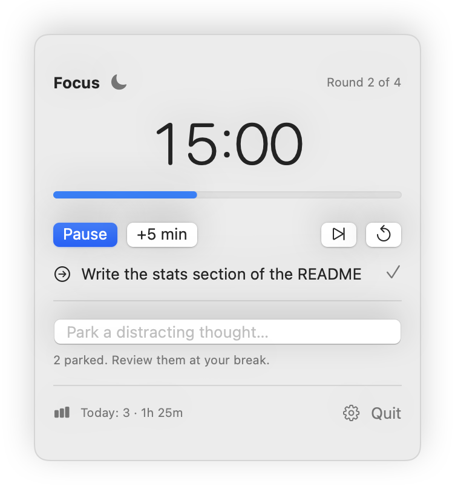
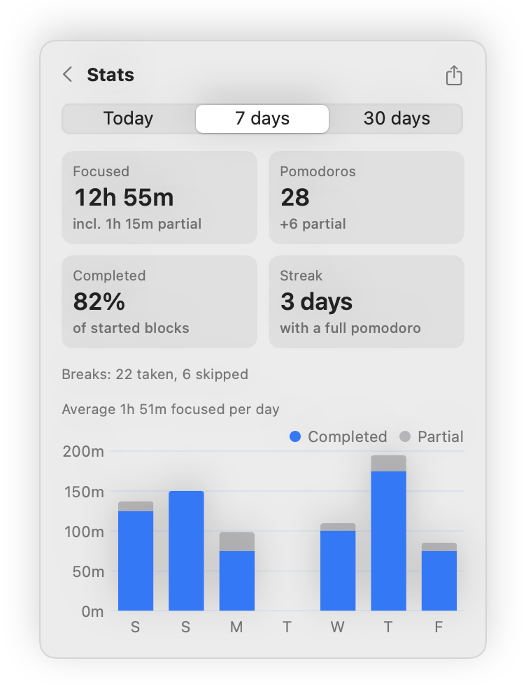
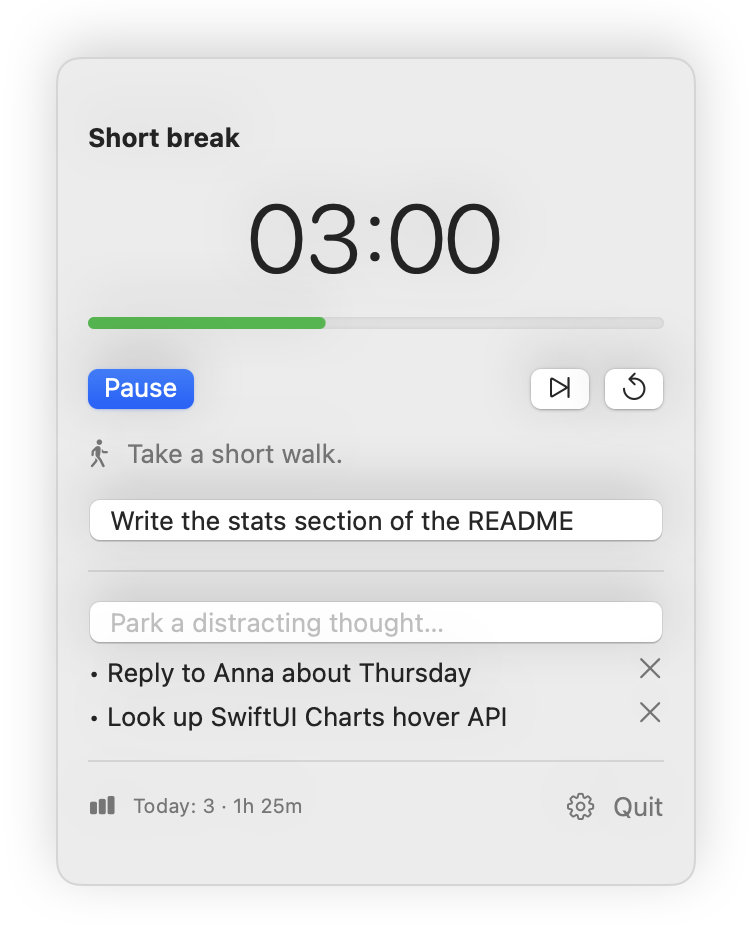
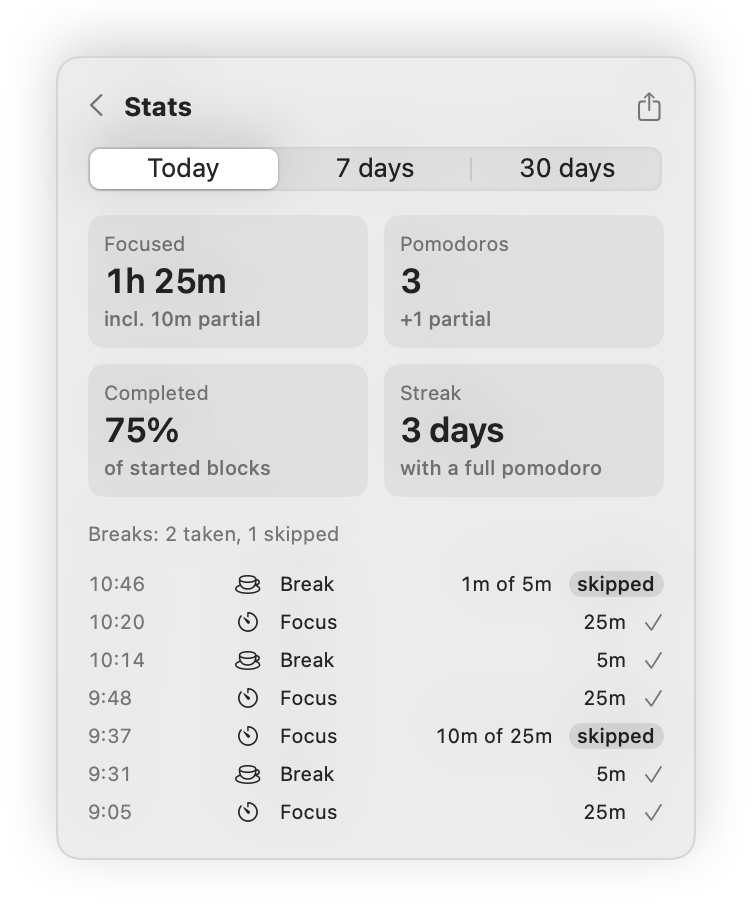
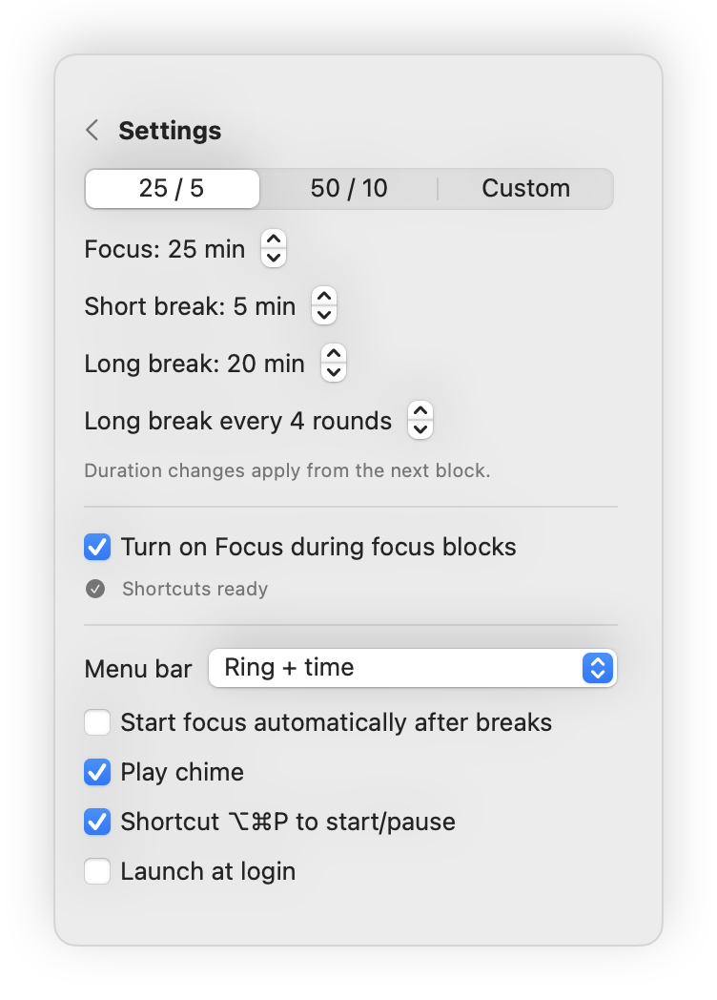

# PomodoroBar

A minimal, native Pomodoro timer for the macOS menu bar. Its defaults come from research on breaks and interruptions;

<p align="center">
  <picture>
    <source media="(prefers-color-scheme: dark)" srcset="docs/screenshots/menubar-dark.png">
    
  </picture>
</p>

<p align="center">
  <picture>
    <source media="(prefers-color-scheme: dark)" srcset="docs/screenshots/timer-dark.png">
    
  </picture>
  <picture>
    <source media="(prefers-color-scheme: dark)" srcset="docs/screenshots/stats-week-dark.png">
    
  </picture>
</p>

<details>
<summary>More screenshots</summary>
<p align="center">
  <picture>
    <source media="(prefers-color-scheme: dark)" srcset="docs/screenshots/break-dark.png">
    
  </picture>
  <picture>
    <source media="(prefers-color-scheme: dark)" srcset="docs/screenshots/stats-today-dark.png">
    
  </picture>
  <picture>
    <source media="(prefers-color-scheme: dark)" srcset="docs/screenshots/settings-dark.png">
    
  </picture>
</p>
</details>

- Lives only in the menu bar (no Dock icon), with a progress ring and minutes left
- 25/5 and 50/10 presets plus custom durations; long break after N rounds
- Breaks start automatically; a focus block can be extended in 5 min steps
- No notifications during focus, one notification and chime when a block ends
- **Honest stats**: a skipped or reset block counts only the time you actually spent, and is shown as partial. Includes today/7/30-day views, a daily chart, streak, and CSV export.
- **macOS Focus** (Do Not Disturb) turns on during focus blocks and off for breaks (setup below)
- **Parking lot** to jot down distracting thoughts without leaving focus
- **Next step** note to make it easier to resume after a break
- Global shortcut ⌥⌘P to start/pause, launch at login

Requires macOS 14 Sonoma or later.

## Install

```sh
git clone https://github.com/kevinwielander/pomodoro-menubar.git
cd pomodoro-menubar
scripts/bundle.sh --install   # builds a universal app and copies it to /Applications
open /Applications/PomodoroBar.app
```

Building needs Xcode 15.3+ (or its command line tools). The app is ad-hoc signed and not notarized.

### Focus mode setup

macOS has no public API for Focus, so PomodoroBar runs two shortcuts that you create once in the Shortcuts app:

| Shortcut name | Action |
|---|---|
| `PomodoroBar Focus On` | **Set Focus** → Do Not Disturb → **Turn On** until **Turned Off** |
| `PomodoroBar Focus Off` | **Set Focus** → Do Not Disturb → **Turn Off** |

Then enable **Turn on Focus during focus blocks** in Settings. To use a different Focus (e.g. Work), pick it in both shortcuts instead.

### Data

Settings live in `UserDefaults` (`com.kevinwielander.PomodoroBar`). Block history is stored in `~/Library/Application Support/PomodoroBar/history.json`.

## Develop

```sh
swift test                                   # timer engine tests
swift run                                    # run unbundled (no notifications)
swift run PomodoroBar --screenshots docs/screenshots   # re-render README screenshots
scripts/bundle.sh                            # build/PomodoroBar.app
open --env POMODOROBAR_FAST=1 build/PomodoroBar.app   # minutes become seconds
```

The timer logic is a pure state machine in `Sources/PomodoroCore/TimerEngine.swift`. The app in `Sources/PomodoroBar` connects it to the clock, `UserDefaults`, notifications and the UI. Running blocks store their end date, so the timer stays correct across sleep and restarts.
